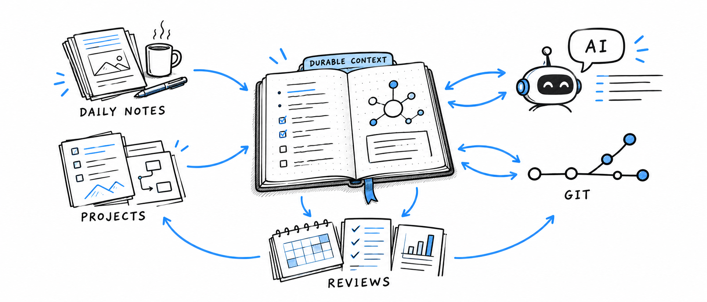

# Durable Context

> An AI-assisted Obsidian workflow for daily notes, projects, and reviews.

This repository is a small, generic, shareable Obsidian vault for daily notes, lightweight project organization, regular review, and AI-assisted reflection.

It started from Mark Bakke's AI-native Obsidian workflow. The source material was adapted into a portable baseline rather than copied as a personal or company-specific system.

The immediate value is practical: manage today's time, remember commitments, and keep tasks from disappearing. Over time, the notes become durable context that you can search and review, and that an AI assistant with access can help curate, summarize, and use to guide you. The system is useful on the first day, but becomes more valuable as the record develops. See [Time Management and Using This Vault](Cheat%20Sheets/Time%20Management%20and%20Using%20This%20Vault.md) and [Time Management in Practice](Cheat%20Sheets/Time%20Management%20in%20Practice.md) for the underlying approach and an example.

## Getting started

1. If you are viewing this on GitHub, use the repository's **Code** menu to clone it or download an archive. If you received an archive, extract it first.
2. Read [Obsidian Setup](Reference/Obsidian%20Setup.md) to install Obsidian and open the repository root as a vault.
3. Read [Quick Start](Cheat%20Sheets/Quick%20Start.md). It is the main workflow onboarding guide.
4. If you use AI, read `AGENTS.md` and follow the [Daily Workflow — AI Instructions](000%20Workflows/000%20Daily%20Workflow.md).

The repository includes optional Obsidian community plugins, but they are disabled by default. See [Obsidian Setup](Reference/Obsidian%20Setup.md) before enabling or removing them.

The vault can live in Dropbox or another synchronized folder for access from multiple computers after the setup is tested on one computer. Mobile syncing has platform-specific limitations; see the sync guidance in [Quick Start](Cheat%20Sheets/Quick%20Start.md). Git commits are still best made from a computer where Git is configured.

## License

Unless otherwise noted, the original Markdown notes, templates, workflow documentation, and accompanying media are licensed under [CC BY-SA 4.0 International](LICENSE.md). Material adapted from Mark Bakke is attributed in [PROVENANCE](Reference/PROVENANCE.md). Third-party plugins, themes, trademarks, and other separately identified material remain under their respective licenses.

## Variations and publishing

In the future, there may be other branches for specific use cases. Each branch is intended to be a complete vault. See [Vault Variation](Reference/VARIATION.md) for how to update a variation from `main`, archive a branch, and review provenance and licensing before sharing.

## AI tools

`AGENTS.md` contains the portable vault guidance. `cursor.md` is a compatibility redirect for Cursor and does not add separate rules. Do not replace a computer's host-level `AGENTS.md` with this file unless that is an intentional choice.

> Note: The GitHub repository is named `AI-Vault`; the user-facing vault and workflow are called Durable Context.
